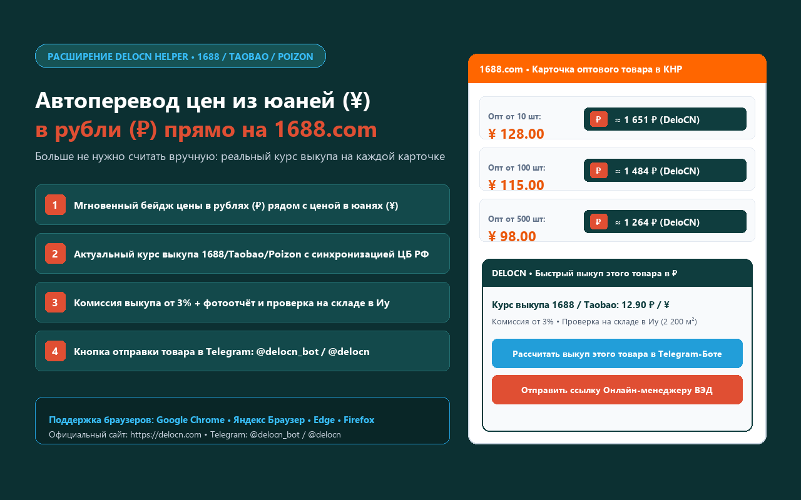
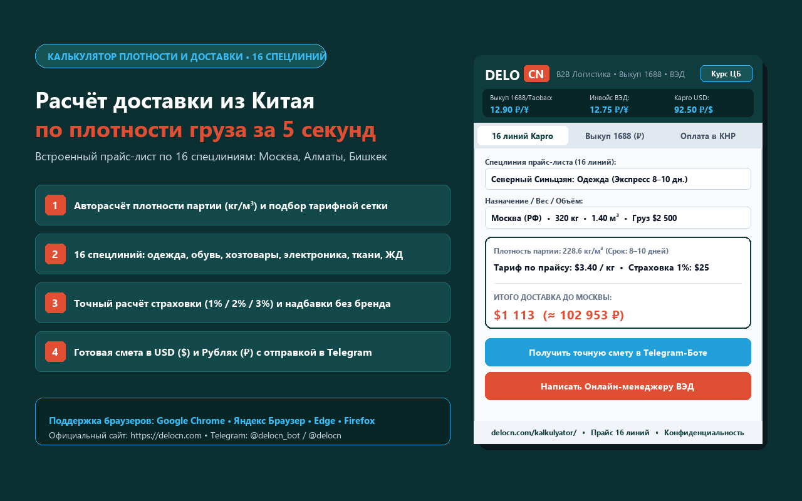
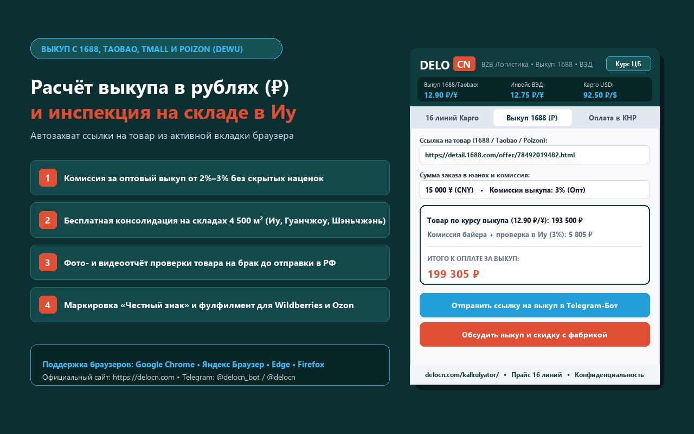
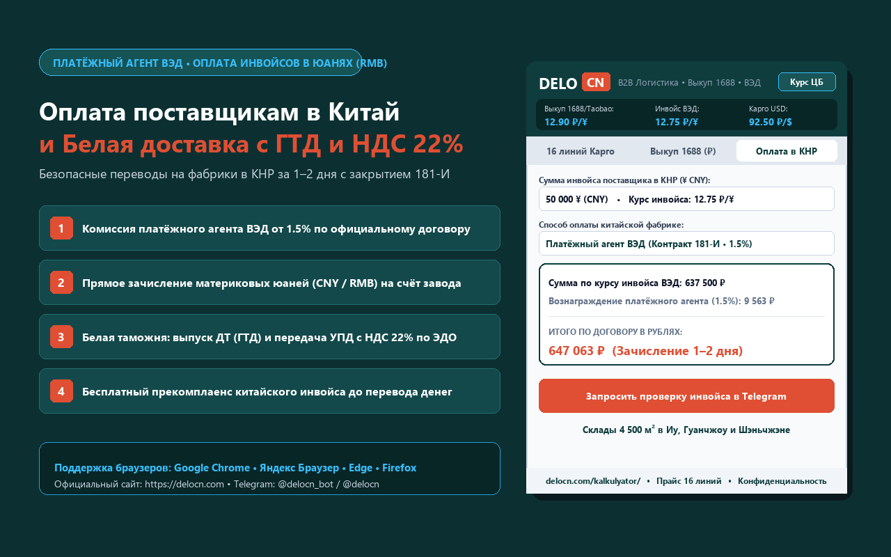

# 🧩 DeloCN Helper: 1688, Taobao и Poizon в рублях (₽) + Калькулятор доставки из Китая (16 спецлиний)

**DeloCN Helper** — бесплатное открытое браузерное расширение (Manifest V3) для российских импортёров, оптовых закупщиков и селлеров **Wildberries / Ozon / Яндекс Маркет**, работающих напрямую с китайскими торговыми площадками **1688.com, Taobao.com, Tmall.com и Poizon (Dewu)**.

Расширение автоматически переводит цены на карточках китайских товаров из юаней (`¥ / CNY`) в российские рубли (`₽ / RUB`) по актуальному коммерческому курсу выкупа и позволяет за 5 секунд рассчитать стоимость доставки партии из Китая в **Москву, Алматы или Бишкек** по 16 специализированным линиям прайс-листа.

---

## 📸 Скриншоты интерфейса расширения

### 1. Автоматический перевод цен 1688.com и Taobao из юаней (¥) в рубли (₽)

### 2. Встроенный калькулятор плотности груза (кг/м³) и доставки по 16 спецлиниям

### 3. Расчёт оптового выкупа с 1688 / Taobao / Poizon (от 3%) со склада в Иу (2 200 м²)

### 4. Расчёт оплаты инвойсов китайским фабрикам в юанях (RMB) и услуг платёжного агента ВЭД

---

## 🚀 Основные функции расширения DeloCN Helper

1. **Автоматический бейдж цены в рублях (`₽`) на 1688, Taobao, Tmall и Poizon**:
   - На каждой карточке товара рядом с ценой в юанях (`¥`) мгновенно отображается точный эквивалент в рублях (`₽`) по актуальному курсу выкупа.
   - Компактная плавающая панель в правом нижнем углу позволяет в 1 клик отправить ссылку на товар в официальный Telegram-бот расчёта **[@delocn_bot](https://t.me/delocn_bot)** или онлайн-менеджеру ВЭД **[@delocn](https://t.me/delocn)**.
2. **Встроенный калькулятор плотности груза (`кг/м³`) и 16 спецлиний прайс-листа**:
   - Автоматический расчёт плотности партии (`Вес кг / Объём м³`) и подбор тарифной ставки по 16 специализированным маршрутам (Северный и Южный Синьцзян Авто-Экспресс, Авто-Стандарт и ЖД):
     - Одежда (Экспресс 8–10 дней и Стандарт 12–15 дней)
     - Обувь, сумки и аксессуары
     - Хозтовары и сборные грузы со склада в г. Иу
     - Моно-грузы, промышленное оборудование, инструмент и автозапчасти (ставки от `$1.00/кг`)
     - Мелкая бытовая техника и электроника (9–11 дней)
     - Ткани и рулонный текстиль
   - Точный расчёт ступенчатой страховки (`1% / 2% / 3%`) и надбавки за небрендированный груз (`+$0.20/кг`).
3. **Калькулятор выкупа (`от 3%`) и оплаты инвойсов в Китай (`от 1.5%`)**:
   - Захват ссылки на текущий товар из активной вкладки браузера.
   - Расчёт оплаты китайским заводам в материковых юанях (`CNY / RMB`) за 1–2 рабочих дня и услуг платёжного агента ВЭД по контракту (инструкция `181-И` ЦБ РФ).

---

## 📦 Поддерживаемые браузеры и установка

Готовые архивы для установки находятся в папке [`/releases`](./releases) и в разделе **Releases** этого репозитория:

| Браузер | Папка исходного кода | Готовый ZIP-архив |
| :--- | :--- | :--- |
| **Google Chrome** | [`/chrome`](./chrome) | [`delocn-chrome-extension-v1.2.0.zip`](./releases/delocn-chrome-extension-v1.2.0.zip) |
| **Яндекс Браузер (Yandex)** | [`/yandex`](./yandex) | [`delocn-yandex-extension-v1.2.0.zip`](./releases/delocn-yandex-extension-v1.2.0.zip) |
| **Microsoft Edge** | [`/edge`](./edge) | [`delocn-edge-extension-v1.2.0.zip`](./releases/delocn-edge-extension-v1.2.0.zip) |
| **Mozilla Firefox** | [`/firefox`](./firefox) | [`delocn-firefox-extension-v1.2.0.zip`](./releases/delocn-firefox-extension-v1.2.0.zip) |

### Быстрая ручная установка (Chrome / Яндекс Браузер / Edge):
1. Скачайте и распакуйте папку [`chrome`](./chrome) (или архив `delocn-chrome-extension-v1.2.0.zip`).
2. Откройте в браузере страницу `chrome://extensions/` (или `browser://extensions/` в Яндекс Браузере, `edge://extensions/` в Edge).
3. Включите переключатель **«Режим разработчика» (Developer mode)** в правом верхнем углу.
4. Нажмите **«Загрузить распакованное расширение» (Load unpacked)** и выберите папку `chrome`.

---

## 🌐 Официальные ресурсы и разделы портала DeloCN

- 🏢 **Официальный сайт B2B-оператора ВЭД**: [https://delocn.com](https://delocn.com)
- 🧮 **Онлайн-калькулятор доставки по плотности (16 спецлиний)**: [https://delocn.com/kalkulyator/](https://delocn.com/kalkulyator/)
- 📋 **Сводная таблица тарифов 2026 и курс юаня**: [https://delocn.com/tarify/](https://delocn.com/tarify/)
- 🚛 **Все виды доставки грузов из Китая в Россию**: [https://delocn.com/dostavka-iz-kitaya/](https://delocn.com/dostavka-iz-kitaya/)
  - [Белая доставка из Китая с ГТД и вычетом НДС 22% (ЭДО)](https://delocn.com/dostavka-iz-kitaya/belaya-dostavka/)
  - [Карго доставка из Китая (16 спецлиний от 8–10 дней)](https://delocn.com/dostavka-iz-kitaya/kargo/)
  - [Доставка и маркировка «Честный знак» для селлеров Wildberries и Ozon](https://delocn.com/dostavka-iz-kitaya/dlya-marketpleysov/)
- 🛒 **Оптовый выкуп товаров из Китая**: [https://delocn.com/vykup-tovarov/](https://delocn.com/vykup-tovarov/)
  - [Выкуп с 1688.com оптом со склада 2 200 м² в г. Иу](https://delocn.com/vykup-tovarov/1688/)
  - [Оптовый выкуп оригинальных товаров с Poizon (Dewu)](https://delocn.com/vykup-tovarov/poizon/)
  - [Выкуп с Taobao и Pinduoduo](https://delocn.com/vykup-tovarov/taobao-pinduoduo/)
  - [Проверка товара на брак и инспекция фабрик в КНР](https://delocn.com/vykup-tovarov/proverka-tovara/)
- 💳 **Оплата поставщикам в Китай**: [https://delocn.com/oplata-v-kitay/](https://delocn.com/oplata-v-kitay/)
  - [Услуги платёжного агента ВЭД по договору (181-И ЦБ РФ, от 1.5%)](https://delocn.com/oplata-v-kitay/platezhnyy-agent/)
  - [Оплата инвойсов на китайские фабрики в материковых юанях (RMB)](https://delocn.com/oplata-v-kitay/oplata-invoysov/)
- 📚 **База знаний импортёра (Статьи, кейсы и разборы таможни 2026)**: [https://delocn.com/blog/](https://delocn.com/blog/)
- 🧩 **Официальная страница браузерного расширения**: [https://delocn.com/browser-extension/](https://delocn.com/browser-extension/)
- 🔒 **Политика конфиденциальности расширения (Privacy Policy)**: [https://delocn.com/extension-privacy/](https://delocn.com/extension-privacy/)

---

## ✉️ Официальные контакты для расчёта и заявок

- 🤖 **Telegram-Бот расчёта 24/7**: [@delocn_bot](https://t.me/delocn_bot) (`https://t.me/delocn_bot`)
- 👨‍💼 **Онлайн-менеджер отдела ВЭД в Telegram**: [@delocn](https://t.me/delocn) (`https://t.me/delocn`)
- ✉️ **Электронная почта**: `info@delocn.com` | `ved@delocn.com`

---

## 🛡️ Конфиденциальность и лицензия

Расширение работает на 100% локально в браузере пользователя, не собирает персональные данные, не отслеживает историю просмотров и не использует удалённый исполняемый код (No Remote Code). Подробная политика: [https://delocn.com/extension-privacy/](https://delocn.com/extension-privacy/). Распространяется по открытой лицензии [MIT License](./LICENSE).
